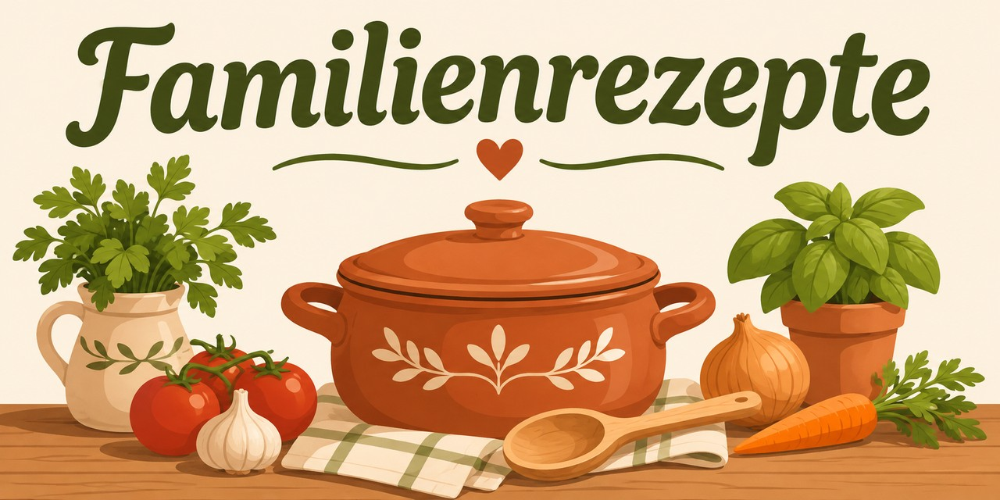

Hier sammeln wir Rezepte für unsere Familie: bewährte Lieblingsgerichte, neue Entdeckungen und alles, was wir gerne wieder kochen oder backen möchten.

Die Sammlung wächst mit der Zeit. Zu jedem Rezept können Zutaten, Mengen und Zubereitungsschritte sowie persönliche Tipps und Varianten festgehalten werden.

Die Rezepte stehen im Ordner [rezepte](rezepte/).

- [Mediterraner Auberginenauflauf mit Mozzarella](rezepte/mediterraner-auberginenauflauf.md)
- [Einfaches Chili sin Carne](rezepte/chili-sin-carne.md)
- [Käse-Lauch-Suppe mit Hack](rezepte/kaese-lauch-suppe.md)
- [Einfache Guacamole](rezepte/einfache-guacamole.md)
